# API Specification & Architecture

This document maps all the APIs in the application directly to the database entities defined in the ER diagram.

---

## 1. Database ER Diagram

```mermaid
erDiagram
    USER ||--o{ REMINDER : "has"
    USER ||--o{ CARD_DESIGN : "customizes"
    EVENT ||--o{ REMINDER : "received by"
    EVENT ||--o{ CARD_DESIGN : "styled by"

    USER {
        ObjectId _id PK
        string email UK
        string password
        string role
        string[] favoriteCategories
        Date createdAt
    }

    EVENT {
        ObjectId _id PK
        string title
        string category
        string city
        Date dateTime
        number price
        string description
        string imageUrl
        boolean isActive
        Date createdAt
    }

    REMINDER {
        ObjectId _id PK
        ObjectId user FK
        ObjectId event FK
        Date createdAt
    }

    CARD_DESIGN {
        ObjectId _id PK
        ObjectId user FK
        ObjectId event FK
        string theme
        string[] stickers
        Date updatedAt
    }
```

---

## 2. Complete List of APIs

All APIs are simple Next.js Route Handlers returning JSON.

### A. Authentication & Session (`USER`)

| Method | Endpoint | Access | What it does |
|---|---|---|---|
| `POST` | `/api/auth/signup` | Public | Registers a new user with hashed password and returns a JWT |
| `POST` | `/api/auth/login` | Public | Validates email & password, returns JWT and sets `auth_token` cookie |
| `GET` | `/api/auth/me` | Authenticated | Returns current logged-in user profile, role, and favorite categories |
| `POST` | `/api/auth/logout` | Authenticated | Clears the `auth_token` cookie |

---

### B. Public Events Discovery (`EVENT`)

| Method | Endpoint | Access | What it does |
|---|---|---|---|
| `GET` | `/api/events` | Public | Returns upcoming, active events sorted nearest-first. Supports filters: `category`, `city`, `search`, and pagination (`page`, `limit`). |
| `GET` | `/api/events/[id]` | Public | Fetches complete details of a single event by its ID for the event detail & customization page. |

---

### C. Admin Event Management (`EVENT` — Admin Only)

| Method | Endpoint | Access | What it does |
|---|---|---|---|
| `GET` | `/api/admin/events` | Admin | Fetches **all** events (including Inactive and Past events) for the admin dashboard. |
| `POST` | `/api/admin/events` | Admin | Creates a new event (`title`, `category`, `city`, `dateTime`, `price`, `description`, `imageUrl`). |
| `PATCH` | `/api/admin/events/[id]/status` | Admin | Toggles `isActive` between `true` and `false` (events are never deleted). |

---

### D. User Personalization & Feed (`USER`)

| Method | Endpoint | Access | What it does |
|---|---|---|---|
| `GET` | `/api/favourites` | Authenticated | Reads the user's saved `favoriteCategories` array. |
| `PUT` | `/api/favourites` | Authenticated | Updates the user's `favoriteCategories` array (e.g. `['Music', 'Food']`). |
| `GET` | `/api/feed` | Authenticated | Returns upcoming, active events matching the user's favorite categories. |

---

### E. Reminders (`REMINDER` — links `USER` + `EVENT`)

| Method | Endpoint | Access | What it does |
|---|---|---|---|
| `GET` | `/api/reminders` | Authenticated | Returns the list of event IDs the user has saved reminders for. |
| `PUT` | `/api/events/[id]/reminder` | Authenticated | Adds a reminder for the given event (idempotent, 1 reminder per user per event). |
| `DELETE` | `/api/events/[id]/reminder` | Authenticated | Removes the user's reminder for the given event. |

---

### F. Card Designer (`CARD_DESIGN` — links `USER` + `EVENT`)

| Method | Endpoint | Access | What it does |
|---|---|---|---|
| `GET` | `/api/events/[id]/card-design` | Authenticated | Retrieves the user's saved card customization (`theme`, `stickers`) for that specific event. |
| `PUT` | `/api/events/[id]/card-design` | Authenticated | Saves or updates the card design (`theme`, `stickers` up to 3) for that user and event. |

---

## 3. Implementation Status Checklist

- [x] `POST /api/auth/signup`
- [x] `POST /api/auth/login`
- [x] `GET /api/auth/me`
- [x] `POST /api/auth/logout`
- [x] `GET /api/events` (with combined filters & pagination)
- [x] `GET /api/events/[id]` (Single event detail)
- [x] `GET & POST /api/admin/events` & `PATCH /api/admin/events/[id]/status` (Admin management)
- [x] `GET & PUT /api/favourites` + `GET /api/feed` (User feed)
- [x] `GET, PUT & DELETE /api/reminders` (Reminder toggles)
- [x] `GET & PUT /api/events/[id]/card-design` (Card designer)
