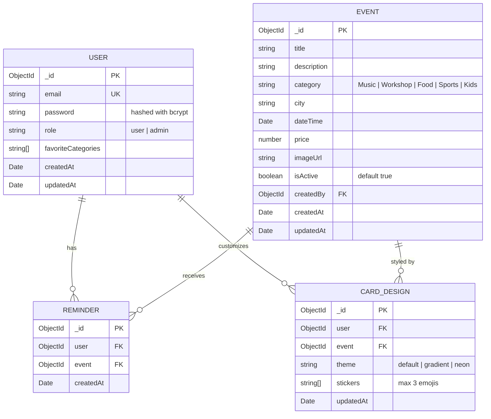

# Community Events Board

A full-stack, responsive web application where an administrator manages community events and visitors discover upcoming happenings, personalize their feed with favourite categories, toggle reminders with optimistic rollback, and customize interactive event passes.

Built with **Next.js (App Router)**, **MongoDB**, **Tailwind CSS**, and **Shadcn UI**.

---

## 1. Quick Start Guide (< 5 Minutes)

### Prerequisites
- [Node.js](https://nodejs.org/) v18.17+ or v20+
- A running MongoDB instance or MongoDB Atlas connection URI

### Step 1: Clone and Install Dependencies
```bash
cd community-events-board
npm install
```

### Step 2: Configure Environment Variables
Create a `.env` file in the `community-events-board` root directory (or use the provided defaults):
```env
MONGODB_URI="mongodb+srv://<username>:<password>@cluster0.yd2rnju.mongodb.net"
JWT_SECRET="events_super_secure_jwt_secret_key_2026"
ADMIN_API_KEY="admin_super_secret_key_2026"
NEXT_PUBLIC_ADMIN_KEY="admin_super_secret_key_2026"
```

### Step 3: Seed the Database
Run the seed script to populate **15 varied sample events** (10 active upcoming, 2 inactive drafts, 3 past events) across all 5 categories and 7 cities, as well as the predefined Admin user:
```bash
npm run seed
```

### Step 4: Run the Development Server
```bash
npm run dev
```
Open [http://localhost:3000](http://localhost:3000) in your browser.

---

## 2. Admin Credentials & Access

A predefined admin account is seeded for local development and review:

| Role | Email | Password | Dashboard URL |
|---|---|---|---|
| **Admin** | `admin@community.com` | `adminpassword123` | [/admin](http://localhost:3000/admin) |
| **User (Demo)** | Register new via [/signup](http://localhost:3000/signup) | Password of your choice | [/user](http://localhost:3000/user) |

> **Reviewer Tip:** The [/login](http://localhost:3000/login) page includes a one-click **"Fill Admin Credentials (Demo)"** button to instantly populate admin credentials.

---

## 3. Application Routes & Key Features

| Route | Access | Key Features |
|---|---|---|
| `/` | Public | Marketing landing page with value highlights and direct quick navigation |
| `/events` | Public | Full event explorer with combined category/city filters, text search, pagination, and reminder controls |
| `/events/:id` | Public | Event details view + interactive **Card Designer** (3 themes, 5 stickers, live preview animation, persistence) |
| `/login` & `/signup` | Public | Email & password registration and login with bcrypt hashing & JWT cookies |
| `/user` | Registered Users | Personal dashboard with **Favourite Categories picker** and personalized **My Feed** |
| `/feed` | Registered Users | Auto-redirects to `/user` personalized feed |
| `/admin` | Admin Only | Server-protected portal: create events with validation, toggle Active/Inactive statuses, status filter tabs |

---

## 4. API Endpoints Surface

All endpoints are Next.js Route Handlers returning JSON responses:

| Method | Endpoint | Access | Description |
|---|---|---|---|
| `POST` | `/api/auth/signup` | Public | Register new user with hashed password; returns JWT & sets cookie |
| `POST` | `/api/auth/login` | Public | Authenticate user or admin; returns JWT & sets `auth_token` cookie |
| `GET` | `/api/auth/me` | Authenticated | Fetch current user session profile, role, and favourite categories |
| `POST` | `/api/auth/logout` | Authenticated | Clear session cookie |
| `GET` | `/api/events` | Public | Fetch upcoming active events with combined category, city, keyword search, and pagination |
| `GET` | `/api/events/:id` | Public | Fetch a single event's complete details |
| `GET` | `/api/admin/events` | Admin | Fetch all events (including inactive drafts & past events) for admin directory |
| `POST` | `/api/admin/events` | Admin | Create a new community event |
| `PATCH`| `/api/admin/events/:id/status`| Admin | Toggle an event's status between `Active` and `Inactive` (retained, never deleted) |
| `GET` | `/api/favourites` | Authenticated | Retrieve the user's favourite event categories |
| `PUT` | `/api/favourites` | Authenticated | Replace/update user's favourite categories |
| `GET` | `/api/feed` | Authenticated | Fetch upcoming active events matching user's favourite categories |
| `GET` | `/api/reminders` | Authenticated | List the event IDs saved to the user's reminders |
| `PUT` | `/api/events/:id/reminder` | Authenticated | Idempotently save a reminder for an event |
| `DELETE`| `/api/events/:id/reminder` | Authenticated | Remove an event reminder |
| `GET` | `/api/events/:id/card-design` | Authenticated | Retrieve user's saved card customization for an event |
| `PUT` | `/api/events/:id/card-design` | Authenticated | Save/update card design (theme + up to 3 stickers) |

---

## 5. Technical Questions & Design Decisions

### Q1. Database Structure & Design Rationale



#### Why was it designed this way?
1. **Embedded Favourite Categories in `User`:** Storing `favoriteCategories: string[]` directly inside the `User` document eliminates expensive `$lookup` joins on every personalized feed query. Since a user has at most 5 predefined categories, embedding is O(1) in size and maximally performant.
2. **Dedicated `Reminder` Collection with Unique Compound Index:** A user can set reminders for multiple events, and an event can be saved by multiple users. We enforce `{ user: 1, event: 1 }` as a unique compound index. This ensures atomicity, avoids duplicate entries, and enables atomic `$setOnInsert` upserts.
3. **Dedicated `CardDesign` Collection with Unique Compound Index:** Similarly, `{ user: 1, event: 1 }` is uniquely indexed in `CardDesign`. This guarantees that each user has exactly one saved design per event while keeping the core `Event` document immutable and clean of user-specific styling states.
4. **Soft Deactivation via `isActive` Flag:** Deactivating an event never deletes it from MongoDB; instead, `isActive: false` is stored, preserving event history, reminder linkages, and admin audits.

---

### Q2. Combined Filtering Query & Indexing Strategy

#### How the Combined Query Works
In `app/api/events/route.ts`, all query parameters (`category`, `city`, keyword `search`, `page`, `limit`) are dynamically assembled into a single MongoDB query object:

```typescript
const query: Record<string, unknown> = {
  isActive: true,
  dateTime: { $gte: new Date() }, // Automatically excludes past events
};

if (category && category !== 'All') {
  query.category = category;
}

if (city && city !== 'All') {
  query.city = { $regex: new RegExp(`^${escapeRegex(city)}$`, 'i') };
}

if (search.trim()) {
  const safeSearch = escapeRegex(search.trim());
  query.$or = [
    { title: { $regex: safeSearch, $options: 'i' } },
    { description: { $regex: safeSearch, $options: 'i' } },
  ];
}
```
All criteria operate simultaneously using logical `AND` semantics. Results are sorted by `{ dateTime: 1 }` (nearest date first) and paginated with `.skip((page - 1) * limit).limit(limit)`.

#### Which Indexes Were Added and Why
1. **Compound Index for Default Listing & Sorting:**
   ```javascript
   EventSchema.index({ isActive: 1, dateTime: 1 });
   ```
   *Why:* The base query always checks `isActive: true` and filters/sorts by upcoming `dateTime: { $gte: now }`. This index completely satisfies the query and sort in a single B-tree traversal without in-memory sorting.

2. **Compound Filter Index for Category & City Queries:**
   ```javascript
   EventSchema.index({ isActive: 1, category: 1, city: 1, dateTime: 1 });
   ```
   *Why:* When a user filters by category and city, MongoDB utilizes this index prefix to jump directly to the relevant subset of active upcoming events.

3. **Compound Text Search Index:**
   ```javascript
   EventSchema.index({ title: 'text', description: 'text' });
   ```
   *Why:* Indexes keywords across titles and descriptions for high-throughput text searching.

---

### Q3. Security Architecture & Server-Side Protection

1. **Password Storage:**
   - User passwords are encrypted with `bcryptjs` using **10 salt rounds** before insertion.
   - The password field has `select: false` in the Mongoose schema so password hashes are never accidentally leaked in API responses.

2. **JWT Authentication:**
   - Upon successful login, a JWT signed with `JWT_SECRET` (HMAC SHA-256) containing `{ userId, email, role }` is generated with a 7-day expiration.
   - The token is set in an `httpOnly`, `SameSite=Lax` cookie and returned in the JSON response for header flexibility.

3. **Server-Side Protection for Admin Pages & APIs:**
   - **Route Protection (Next.js Middleware):** Intercepts requests to `/admin/*` and `/api/admin/*`. Decodes the token, checks token expiration, and verifies `role === 'admin'`. Non-admin users are rejected at the edge with HTTP 403 or redirected to `/user`.
   - **API Protection (Route Handlers):** Each admin API endpoint calls `verifyAdmin(request)` to cryptographically verify the JWT and enforce `role === 'admin'` before performing database operations.
   - **Protection does not rely on hiding UI elements:** If an unauthenticated user or regular user sends requests directly to `/api/admin/events`, the server rejects them with HTTP 401/403.

---

## 6. Verification & Implementation Checklist

- [x] **A1. Admin Authentication & Server-Side Authorization:** Predefined admin login, server-protected `/admin` page and `/api/admin/*` endpoints.
- [x] **A2. Create Event:** Complete form with title, category, city, date/time, price, description, image URL, and active status.
- [x] **A3. Event Status Management:** Admins toggle Active/Inactive statuses; inactive events remain in MongoDB and are excluded from public lists.
- [x] **B1. Public Events Page:** Only active upcoming events, sorted nearest date first, excluding past events.
- [x] **B2. Combined Filters & Search:** Category filter + city filter + keyword text search + pagination working simultaneously.
- [x] **B3. Signup and Login:** Email/password registration, bcrypt hashing, JWT issuance in cookies.
- [x] **B4. Favourite Categories:** Selection of categories, persistent storage in user document across logins and refreshes.
- [x] **B5. My Feed:** Displays active upcoming events matching user favourite categories with empty states.
- [x] **B6. Reminders with Optimistic Rollback:** Immediate UI state toggle with rollback on server failure and toast notification.
- [x] **C. Event Card Designer:** 3 background themes, 5 emoji stickers, max 3 stickers, remove sticker control, live smooth animation, saved to MongoDB and restored on refresh.
- [x] **D. UI Quality & Indian Formatting:** Rupee formatting (e.g. `₹1,200`, `Free`), friendly date formatting (`Sat, 18 Oct, 6:30 PM`), fully responsive across phone and laptop viewports.
- [x] **15 Varied Seed Events:** Covering all categories, cities, active upcoming, inactive, and past states.
- [x] **Documentation:** Setup in < 5 mins, admin credentials, complete API list, and 3 technical architectural answers.

---

## 7. Submission Notes

- **Screen Recording:** A 3- to 4-minute demonstration walking through the desktop and mobile views of the public events board, combined search/filter, reminder toggling with optimistic feedback, card designer live preview, user feed personalization, and admin creation/status toggles.
- **Incomplete Features:** None. All specified functional and technical requirements from `community_events_board_specification.md` are implemented and passing production builds.
